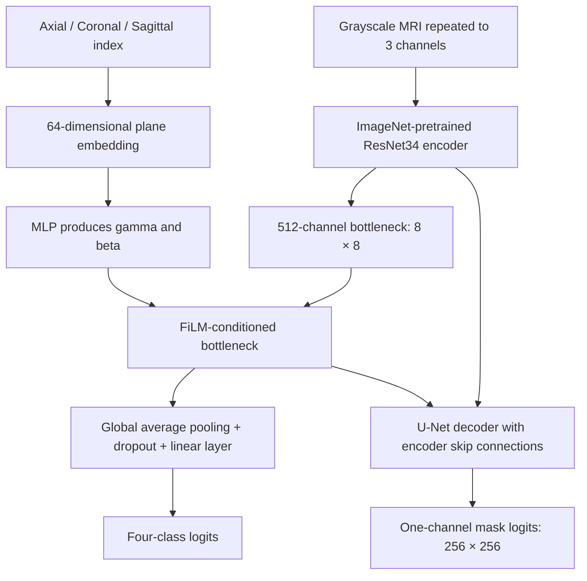

# BRISC 2025: Plane-Conditioned, Uncertainty-Aware Multi-Task Brain MRI

[](https://colab.research.google.com/github/Wilayat-1472/brisc2025-trustworthy-multitask-mri/blob/main/notebooks/brisc2025_multitask_pipeline.ipynb)
[](https://github.com/Wilayat-1472/brisc2025-trustworthy-multitask-mri/actions/workflows/tests.yml)

A PyTorch research project that jointly classifies brain MRI slices and segments tumor regions using a shared ResNet34 encoder, anatomical-plane conditioning, and a U-Net decoder. The experiment also examines near-duplicate overlap in the dataset, conformal prediction sets, Monte Carlo dropout uncertainty, and Grad-CAM visualizations.

**Research use only. This model and its interfaces have not been validated for clinical diagnosis.**

This README documents the experiment actually run in [the original Colab notebook](https://colab.research.google.com/drive/1WFaUv4aDm8Tn7qee8PqLJ5wr17NdKpQA), including its saved outputs. It also explains the portable package and interfaces added afterward. The original scores below belong to that Colab experiment; they are not results of retraining the refactored package.

## Contents

- [What was completed](#what-was-completed)
- [Dataset and manifest construction](#dataset-and-manifest-construction)
- [Similarity audit and experimental splits](#similarity-audit-and-experimental-splits)
- [Preprocessing and augmentation](#preprocessing-and-augmentation)
- [Model architecture](#model-architecture)
- [Training configuration and recorded progress](#training-configuration-and-recorded-progress)
- [Held-out test results](#held-out-test-results)
- [Conformal prediction](#conformal-prediction)
- [Uncertainty and Grad-CAM](#uncertainty-and-grad-cam)
- [Run the local interface](#run-the-local-interface)
- [Use the portable Colab workflow](#use-the-portable-colab-workflow)
- [Prepare data, train, and evaluate locally](#prepare-data-train-and-evaluate-locally)
- [Repository structure](#repository-structure)
- [Validation and limitations](#validation-and-limitations)

## What was completed

The original Colab experiment:

1. Downloaded BRISC 2025 using `kagglehub` and inspected an image, its supplied tumor mask, and their overlay.
2. Joined the classification images to segmentation masks by filename stem and verified that the referenced files existed.
3. Computed perceptual hashes, identified similarity groups, audited overlap in the official split, and saved a group-disjoint experimental manifest.
4. Trained a plane-conditioned multi-task model for 12 epochs on CUDA in a Colab notebook configured for a T4 GPU.
5. Selected and saved `best_brisc_model.pt` using validation classification and segmentation performance.
6. Evaluated classification, tumor segmentation, healthy-scan false alarms, and conformal prediction on the experimental test set.
7. Generated a three-example visualization showing MRI inputs, ground-truth masks, predicted masks, uncertainty, and Grad-CAM.
8. Attempted a Gradio upload interface and wrote a standalone Gradio script. The saved interactive run recorded a `NameError` for `predict_with_uncertainty_and_cam`; it does not establish successful end-to-end upload inference in that original runtime.

The subsequent repository work added an importable `brisc_mri` package, a Streamlit upload interface, a portable Colab/Gradio workflow, checkpoint compatibility, automated tests, and a revised training protocol with separate validation and calibration groups. The existing local checkpoint was successfully loaded and exercised with a synthetic input. That execution check does not independently reproduce its medical performance.

## Dataset and manifest construction

Source: [BRISC 2025 on Kaggle](https://www.kaggle.com/datasets/briscdataset/brisc2025).

The downloaded dataset manifest contained **15,586 file entries**. The notebook reported 5,000 training and 1,000 test entries for classification, plus 7,866 training and 1,720 test entries for the segmentation task. The segmentation counts describe manifest entries, including image/mask files; they are not additional independent classification scans.

The multi-task table was built from the **6,000 classification images**. The notebook normalized path separators, matched mask filenames to image stems, retained class and plane metadata, and checked image and mask paths. Its saved output reported **zero missing images and zero missing referenced masks**.

| Class | Images | Mask handling |
| :--- | ---: | :--- |
| Glioma | 1,401 | Supplied tumor mask |
| Meningioma | 1,635 | Supplied tumor mask |
| Pituitary | 1,757 | Supplied tumor mask |
| No tumor | 1,207 | Generated all-zero mask |
| **Total** | **6,000** | **4,793 tumor-positive images with masks** |

The committed manifest contains 1,993 axial (`ax`), 1,981 coronal (`co`), and 2,026 sagittal (`sa`) images. The class order is `glioma`, `meningioma`, `pituitary`, `no_tumor`; the plane order is `ax`, `co`, `sa`.

The raw MRI dataset is not stored in this repository. The derived table is preserved as [data/brisc2025_clean.csv](data/brisc2025_clean.csv).

## Similarity audit and experimental splits

The notebook computed a 64-bit perceptual hash for each classification image. It connected pairs whose Hamming distance was **at most 6**, then used connected components to assign the manifest's `pseudo_patient_id` values. Connected components can include images linked through intermediate neighbors, even when a particular pair exceeds that distance.

The saved audit reported:

| Audit item | Result |
| :--- | ---: |
| Images examined | 6,000 |
| pHash similarity groups | 3,650 |
| Groups spanning official train and test | 420 |
| Official test images in those overlapping groups | 559 / 1,000 |

These are **image-similarity groups**, not verified patient identifiers. This audit demonstrates near-duplicate overlap under the chosen rule; it does not prove patient identity or eliminate every possible source of leakage.

The notebook constructed two protocols:

- **Official protocol:** retained the original 1,000-image test set and divided the original training pool by group for training and validation/calibration. Its official train/test similarity overlap remained.
- **Strict protocol:** used five-fold `StratifiedGroupKFold` across all 6,000 images, with class-plus-plane as the stratification target and pHash groups kept together. Fold 0 became test, fold 1 became validation/calibration, and folds 2–4 became training.

**The training and results documented here used the strict protocol.** Its test set is a newly assigned experimental split, rather than the original official 1,000-image test set.

| Strict subset | Glioma | Meningioma | Pituitary | No tumor | Total | Similarity groups |
| :--- | ---: | ---: | ---: | ---: | ---: | ---: |
| Training | 841 | 980 | 1,055 | 723 | **3,599** | 2,227 |
| Validation/calibration | 280 | 327 | 351 | 242 | **1,200** | 738 |
| Test | 280 | 328 | 351 | 242 | **1,201** | 685 |

No recorded pHash group crosses these strict subsets. References to “leak-free” or “pseudo-patients” in the original notebook should be read with this narrower, group-based meaning.

## Preprocessing and augmentation

Each sample supplied an image tensor, binary mask, class index, and anatomical-plane index.

1. Convert the MRI slice to grayscale.
2. Resize the image to **256 × 256** with bilinear interpolation.
3. Resize the supplied mask with nearest-neighbor interpolation, or create a zero mask for a healthy image.
4. During training, apply synchronized horizontal flipping with probability 0.5 and, independently with probability 0.5, rotation sampled uniformly from **−15° to +15°** to both image and mask.
5. Repeat the grayscale image into three channels and normalize using ImageNet mean `[0.485, 0.456, 0.406]` and standard deviation `[0.229, 0.224, 0.225]`.
6. Binarize the mask at 0.5.

Validation and test samples were processed without augmentation. A recorded training batch had image shape `[16, 3, 256, 256]` and mask shape `[16, 1, 256, 256]`.

## Model architecture

The notebook reported **24.63 million parameters**. A single shared network produces four class logits and one tumor-mask logit map.



**Encoder:** ResNet34 initialized with `ResNet34_Weights.DEFAULT`. Spatial resolution decreases from 256 × 256 to an 8 × 8, 512-channel bottleneck.

**Plane conditioning:** an embedding maps the plane index to 64 dimensions. An MLP with widths `64 → 256 → 1024` produces 512 scale and 512 shift values. Feature-wise linear modulation applies:

```text
conditioned_features = bottleneck × (1 + gamma) + beta
```

**Classification head:** adaptive average pooling, flattening, dropout with probability 0.3, and a linear layer from 512 features to four classes.

**Segmentation head:** four decoder blocks use transposed convolutions, encoder skip connections, convolution, batch normalization, ReLU, and `Dropout2d(0.1)`. A final upsampling layer restores 256 × 256 resolution and outputs one channel. Sigmoid converts mask logits to probabilities; a threshold of 0.5 produces binary masks.

## Training configuration and recorded progress

| Setting | Original Colab configuration |
| :--- | :--- |
| Epochs | 12 |
| Batch size | 16 |
| DataLoader workers | 2, with pinned memory |
| Initialization | ImageNet-pretrained ResNet34 |
| Optimizer | AdamW |
| Initial learning rate | `3e-4` |
| Weight decay | `1e-4` |
| Learning-rate schedule | Cosine annealing over 12 epochs; minimum `1e-6` |
| Classification loss | Cross-entropy with label smoothing `0.05` |
| Segmentation loss | `0.5 × BCEWithLogits + 0.5 × (1 − soft Dice)` |
| Combined loss | `classification_loss + 1.5 × segmentation_loss` |
| Precision | CUDA autocast and gradient scaling |
| Seed explicitly set before training | `torch.manual_seed(42)` |
| Checkpoint selection | Highest `0.5 × validation macro-F1 + 0.5 × validation tumor Dice` |
| Saved artifact | `/content/best_brisc_model.pt`, a raw `model.state_dict()` |

The original code explicitly seeded PyTorch before model initialization but did not fully seed all augmentation and numerical sources. Exact reruns are therefore not guaranteed.

The following values are transcribed from the original notebook's saved training output:

| Epoch | Training loss | Validation macro-F1 | Validation tumor Dice | Saved best |
| ---: | ---: | ---: | ---: | :---: |
| 1 | 1.4752 | 0.8957 | 0.0000 | Yes |
| 2 | 0.9316 | 0.9633 | 0.0000 | Yes |
| 3 | 0.7890 | 0.9736 | 0.7803 | Yes |
| 4 | 0.7051 | 0.9641 | 0.8089 | Yes |
| 5 | 0.6639 | 0.9740 | 0.8105 | Yes |
| 6 | 0.6224 | 0.9886 | 0.8257 | Yes |
| 7 | 0.5944 | 0.9815 | 0.8300 | No |
| 8 | 0.5772 | 0.9884 | 0.8388 | Yes |
| 9 | 0.5519 | 0.9901 | 0.8423 | Yes |
| 10 | 0.5384 | 0.9860 | 0.8472 | Yes |
| 11 | 0.5344 | 0.9900 | 0.8466 | Yes |
| 12 | 0.5315 | 0.9916 | 0.8473 | Yes |

Epoch 12 was the last saved best checkpoint. Reported epoch times ranged from 32.4 to 41.7 seconds in that runtime; these are observations from one run, not runtime guarantees.

## Held-out test results

The notebook reloaded the best checkpoint and evaluated **1,201 test images** from the pHash-group-disjoint strict split. These are recorded original-experiment outputs, not a fresh evaluation performed during the repository refactor.

| Metric | Recorded result | Interpretation |
| :--- | ---: | :--- |
| Classification accuracy | **99.58%** | 1,196 / 1,201 correct |
| Classification macro-F1 | **0.9958** | Unweighted mean across four classes |
| Tumor segmentation Dice | **0.8401** | Mean per-image Dice over 959 tumor-positive test images |
| Tumor segmentation IoU | **0.7573** | Mean per-image intersection-over-union over tumor-positive images |
| Healthy scans with more than 10 foreground pixels | **6 / 242** | False-alarm rule used by the notebook |
| Healthy scans with at most 10 foreground pixels | **236 / 242 (97.52%)** | Scan-level threshold statistic; not pixel-level specificity |

Segmentation metrics used a mask threshold of 0.5 and smoothing constant `1e-5`. Healthy images were excluded from the reported tumor Dice and IoU averages.

### Per-class classification report

| Class | Precision | Recall | F1 | Support |
| :--- | ---: | ---: | ---: | ---: |
| Glioma | 0.9964 | 0.9964 | 0.9964 | 280 |
| Meningioma | 0.9939 | 0.9939 | 0.9939 | 328 |
| Pituitary | 1.0000 | 0.9943 | 0.9971 | 351 |
| No tumor | 0.9918 | 1.0000 | 0.9959 | 242 |
| **Macro average** | **0.9955** | **0.9962** | **0.9958** | **1,201** |
| **Weighted average** | **0.9959** | **0.9958** | **0.9958** | **1,201** |

No external-dataset evaluation, repeated-seed study, confidence intervals, or ablation study is established by this run. In particular, these scores do not quantify the isolated benefit of FiLM or multi-task training.

## Conformal prediction

After selecting the checkpoint, the original notebook used the same **1,200-image validation/calibration pool** to calculate nonconformity scores:

```text
score_i = 1 − P(true_class_i)
alpha = 0.05
q_level = ceil((n_cal + 1) × (1 − alpha)) / n_cal
q_hat = quantile(scores, q_level, method="higher")
prediction_set(x) = {class c : P(c | x) ≥ 1 − q_hat}
```

| Original-run conformal output | Recorded value |
| :--- | ---: |
| Nominal coverage target | 95% |
| Threshold, rounded in notebook output | `0.0579` |
| Empirical test coverage | **95.67%** |
| Average prediction-set size | **0.958** classes |
| Sets with more than one class | **0 / 1,201** |

Average set size below one means that some sets were empty. The notebook's ambiguity counter only counted sets larger than one, so its zero count must not be interpreted as every scan receiving a valid singleton prediction.

**Protocol limitation:** validation data influenced checkpoint selection and was then reused for calibration. Consequently, this run does not establish the usual independent-calibration split-conformal coverage guarantee. The observed coverage is an empirical result on this particular test set, not a per-scan confidence guarantee.

The current package changes this protocol: it partitions the original `val_cal` pool into separate group-disjoint validation and calibration subsets using `GroupShuffleSplit` with seed 42. Validation selects the checkpoint; calibration occurs after that checkpoint is frozen. Its finite-sample threshold uses the `ceil((n + 1) × (1 − alpha))`-th ordered score, returning threshold 1 when that rank exceeds the available samples. This differs from the original quantile implementation and requires a new run for its own results. Exchangeability and deployment-shift assumptions still matter.

The original raw checkpoint contains **no saved calibration threshold or alpha**. The current interfaces therefore disable conformal sets for those weights. The rounded historical `0.0579` is not silently attached to a checkpoint. New package-trained checkpoints store calibration metadata, class/plane ordering, and split provenance. Both empty and multi-class sets request review in the current interfaces.

## Uncertainty and Grad-CAM

The original visualization selected the first test example from each tumor class and produced a **3 × 5 panel**:

1. Input T1 MRI slice.
2. Supplied ground-truth tumor-mask overlay.
3. Predicted binary-mask overlay with per-example Dice.
4. Pixel uncertainty from 10 Monte Carlo dropout passes.
5. Classifier Grad-CAM, with a thresholded CAM/mask IoU displayed for illustration.


The original helper enabled both classifier `Dropout` and decoder `Dropout2d` while keeping batch normalization in evaluation mode. It averaged class probabilities and segmentation probabilities over 10 stochastic passes and computed pixel-wise standard deviation for the uncertainty map. Its three-example Grad-CAM figure targeted each example's **known true class**.

The current upload interfaces instead use deterministic classification, enable only decoder `Dropout2d` for segmentation sampling, and target the **predicted class** for Grad-CAM. This keeps classification aligned with the current calibration procedure and avoids requiring a known diagnosis for an upload.

Dropout variation is not a validated probability of pixel error. Grad-CAM is a coarse attribution map, not a tumor boundary or causal explanation. The saved three-example figure is qualitative evidence and does not replace aggregate evaluation.

## Run the local interface

Use Python **3.10 or newer**. From a fresh checkout:

```bash
git clone https://github.com/Wilayat-1472/brisc2025-trustworthy-multitask-mri.git
cd brisc2025-trustworthy-multitask-mri
python3 -m venv .venv
source .venv/bin/activate
python -m pip install -e ".[data,dev]"
```

Place an existing trained checkpoint at:

```text
checkpoints/best_brisc_model.pt
```

Then launch:

```bash
python -m streamlit run app.py
```

Open **http://localhost:8501**. The checkpoint path can also be entered in the sidebar or supplied through `BRISC_CHECKPOINT`. A fresh clone does not include the weights: `.pt` files are excluded from Git. The interface can start without weights, but analysis remains disabled until a checkpoint is supplied; it does not substitute randomly initialized weights.

To analyze a slice:

1. Upload one PNG or JPEG T1 MRI slice.
2. Select Axial, Coronal, or Sagittal to match its orientation.
3. Choose the number of MC dropout passes and click **Analyze MRI slice**.
4. Inspect class probabilities, segmentation, uncertainty, and Grad-CAM. Download the JSON report, binary-mask PNG, or visualization PNG.

Uploads are processed in memory. Masks and maps use the model's 256 × 256 grid. The interface does not parse DICOM/NIfTI volumes or infer anatomical plane automatically. Class probabilities are model outputs and should not be interpreted as diagnostic certainty.

## Use the portable Colab workflow

Open [notebooks/brisc2025_multitask_pipeline.ipynb](https://colab.research.google.com/github/Wilayat-1472/brisc2025-trustworthy-multitask-mri/blob/main/notebooks/brisc2025_multitask_pipeline.ipynb) and select a GPU runtime for training.

1. Run setup to clone the repository and install `.[data,colab]`.
2. Run dataset download and manifest validation. The cell prints the training, validation, calibration, and test sizes for the revised protocol.
3. Either copy existing weights into `checkpoints/`, or set `RUN_TRAINING = True` to train and calibrate a new checkpoint. Training defaults to `False`.
4. Set `RUN_EVALUATION = True` to evaluate the frozen checkpoint. Evaluation defaults to `False`.
5. Run the Gradio cell, which imports the predictor and visualization functions explicitly.
6. Run the final download cell before ending the runtime to save the checkpoint to your computer.

The original executed notebook is available through [the supplied Colab link](https://colab.research.google.com/drive/1WFaUv4aDm8Tn7qee8PqLJ5wr17NdKpQA). The repository also preserves the original core experiment source, with outputs cleared, in [notebooks/historical_experiment.ipynb](notebooks/historical_experiment.ipynb). Its hardcoded Kaggle/Colab paths must be adapted if rerunning that historical code.

## Prepare data, train, and evaluate locally

Download and discover the dataset root:

```bash
python -m brisc_mri.prepare
```

Or validate an existing copy:

```bash
python -m brisc_mri.prepare --data-root /path/to/brisc2025
```

The root must contain `classification_task/` and `segmentation_task/`. The package rebases the committed manifest's historical paths, checks files and required masks, and verifies recorded group separation. It reuses the existing pHash group assignments; preparation does not recompute the original similarity audit.

Train with the revised, separate validation/calibration protocol:

```bash
python -m brisc_mri.train \
  --data-root /path/to/brisc2025 \
  --pretrained \
  --epochs 12 \
  --batch-size 16 \
  --workers 0 \
  --output checkpoints/new_calibrated_model.pt
```

`--pretrained` downloads ImageNet encoder weights, matching the original initialization choice. Omitting it initializes the encoder without those weights. Training uses CUDA when available and CPU otherwise. Inference loads the supplied checkpoint without an ImageNet download. The separate output filename above preserves an existing original checkpoint.

Evaluate either checkpoint explicitly:

```bash
python -m brisc_mri.evaluate \
  --data-root /path/to/brisc2025 \
  --checkpoint checkpoints/new_calibrated_model.pt \
  --output reports/test_metrics.json
```

Evaluation reports classification, tumor segmentation, and healthy-scan false alarms. It reports conformal metrics only when calibration metadata is available. Generated reports are ignored by Git.

New evaluation reports include SHA-256 hashes of the checkpoint and manifest,
test similarity-group and tumor-positive counts, and separate empty/multi-class
conformal-set counts. Manifest validation rejects repeated image paths and exact
hashes shared across strict splits, even if their similarity-group IDs differ.
Calibration rejects invalid labels, nonfinite values and unnormalized probabilities.
These checks do not change or reproduce the historical scores above.

## Repository structure

```text
app.py                                  Streamlit upload interface
brisc_mri/
  data.py                               Manifest, preprocessing, datasets, splits
  model.py                              ResNet34, FiLM, and U-Net decoder
  losses.py                             BCE/Dice loss and tumor Dice
  prepare.py                            Dataset discovery/download and validation
  train.py                              Training, selection, held-out calibration
  evaluate.py                           Frozen-checkpoint test reporting
  inference.py                          Checkpoint loading, MC masks, Grad-CAM
  visualization.py                      In-memory visualization export
notebooks/
  brisc2025_multitask_pipeline.ipynb      Portable package-based Colab workflow
  historical_experiment.ipynb            Original core experiment, outputs cleared
data/brisc2025_clean.csv                 6,000-image derived manifest
assets/brisc2025_clinical_diagnostics.png Original qualitative visualization
checkpoints/README.md                    Model-weight handling instructions
docs/                                   Methodology, historical results, Git guide
tests/test_pipeline.py                   Synthetic pipeline/interface checks
.github/workflows/tests.yml              CPU test workflow
pyproject.toml                          Package and dependency configuration
```

## Validation and limitations

Run the automated checks with:

```bash
python -m pytest -q
```

The current local suite passes **14 tests**, including regressions for calibration input validation and exact-duplicate split checks. It covers committed-manifest group separation, path rebasing and preprocessing, required masks, model/checkpoint compatibility, synthetic full inference, conformal edge cases, Grad-CAM cleanup, visualization export, notebook syntax and cleared outputs, and interface behavior with missing weights and changed inputs. Tests use synthetic inputs and temporary weights; they do not establish accuracy on real MRI data.

The existing local `best_brisc_model.pt` also passed strict state-dictionary loading and a synthetic inference check. It had no calibration metadata. A compatibility check alone cannot verify checkpoint training provenance or reproduce the notebook's reported scores.

Scientific limitations include:

- pHash groups do not establish patient-level independence, and related slices may escape the similarity rule.
- The original validation/calibration reuse limits interpretation of its conformal coverage.
- Results come from one recorded experiment on one dataset; external generalization and clinical performance remain unverified.
- The model processes 2D slices, with no 3D context or multi-sequence fusion.
- Plane selection is supplied by the user and can be incorrect.
- Segmentation, classification, uncertainty, and attribution can disagree.
- The refactored protocol has software checks but no newly reproduced dataset-level scores reported here.

See [methodology and limitations](docs/methodology.md), [the preserved historical result table](docs/historical_results.md), and [GitHub sharing instructions](docs/github.md) for supporting details. Historical wording in older artifacts should be interpreted using the qualifications above.

## License and artifacts

Code is distributed under the [MIT License](LICENSE). The dataset and trained-model artifacts remain subject to their applicable terms; the code license does not replace those terms.

Raw datasets, checkpoints, virtual environments, secrets, and generated reports are excluded from ordinary Git commits. Share model weights separately through an appropriate model host or GitHub Release, with training provenance and a checksum. No downloadable model release is established by the source repository alone.
