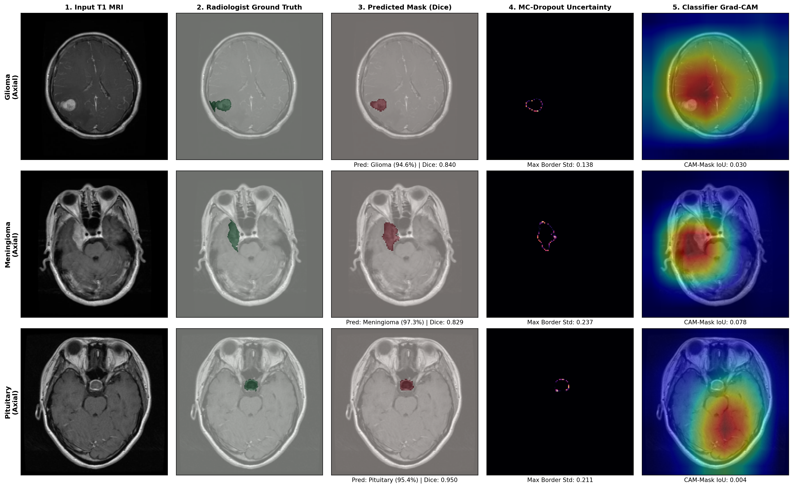

# BRISC 2025 · Multi-Task Brain MRI Research

[](https://github.com/Wilayat-1472/brisc2025-trustworthy-multitask-mri/actions/workflows/tests.yml)
[](https://colab.research.google.com/github/Wilayat-1472/brisc2025-trustworthy-multitask-mri/blob/main/notebooks/brisc2025_multitask_pipeline.ipynb)

A PyTorch research pipeline and upload interface for four-class brain MRI
classification and tumor segmentation on BRISC 2025. The model combines a
ResNet34 encoder, anatomical-plane conditioning through FiLM, and a U-Net decoder.
It provides MC dropout segmentation uncertainty and Grad-CAM for the predicted class.

**Research use only. This project has not been validated for clinical diagnosis.**

## Run the interface

Use Python 3.10 or newer. Run these commands from the repository root:

```bash
python -m venv .venv
source .venv/bin/activate
python -m pip install -e ".[data,dev]"
streamlit run app.py
```

Open **http://localhost:8501**. Copy your Colab `best_brisc_model.pt` into
`checkpoints/` before analyzing a scan. Alternatively, enter its path in the
sidebar or set `BRISC_CHECKPOINT`. The interface starts without weights and
explains how to supply them. It never runs a randomly initialized model.

Upload a PNG/JPEG T1 MRI slice, select its anatomical plane, and click
**Analyze MRI slice**. Results include class probabilities, a tumor mask,
pixel uncertainty, Grad-CAM, and downloadable PNG/JSON files. Maps and mask
exports use the model's 256 × 256 resolution. The app processes uploads in
memory. DICOM and NIfTI volume parsing are not included.

Original notebook `model.state_dict()` checkpoints are supported. They do not
contain calibration metadata, so conformal sets are disabled for those weights.
New checkpoints trained with this package include their own calibration threshold.
No historical threshold is silently reused.

## Project structure

```text
app.py                              Streamlit upload interface
brisc_mri/
  data.py                           Manifest validation, path rebasing, datasets
  model.py                          Notebook-compatible ResNet34 / FiLM U-Net
  losses.py                         BCE/Dice objective and tumor Dice
  prepare.py                        Dataset discovery/download and validation
  train.py                          Training, model selection, held-out calibration
  evaluate.py                       Frozen-checkpoint test evaluation
  inference.py                      Checkpoint loading, MC masks, Grad-CAM
  visualization.py                  In-memory visualization
notebooks/
  brisc2025_multitask_pipeline.ipynb  Portable Colab/local workflow + Gradio interface
  historical_experiment.ipynb        Original experimental source, outputs cleared
checkpoints/                        Local weights; binaries ignored by Git
data/brisc2025_clean.csv             Original pHash-grouped 6,000-image manifest
assets/                             Historical research visualization
docs/                               Methodology, original results, GitHub instructions
tests/                              Pipeline and interface checks
.github/workflows/tests.yml         CPU checks on push and pull request
```

## Prepare data

The repository contains the manifest, not the MRI dataset. To download BRISC:

```bash
python -m brisc_mri.prepare
```

This prints the dataset root. You can also use an existing dataset:

```bash
python -m brisc_mri.prepare --data-root /path/to/brisc2025
```

The root must contain `classification_task/` and `segmentation_task/`. The
loader rebases historical Kaggle paths from the CSV to your local dataset root,
checks file existence, requires masks for tumor-positive images, and checks
similarity-group separation. The original CSV is preserved.

## Train and evaluate

```bash
python -m brisc_mri.train --data-root /path/to/brisc2025 --pretrained --epochs 12
python -m brisc_mri.evaluate --data-root /path/to/brisc2025
```

Training uses CUDA when available and runs on CPU otherwise. `--pretrained`
downloads ImageNet encoder weights; omit it to initialize the encoder locally.
Inference never needs an ImageNet download. Use `--batch-size` to adjust memory
usage and `--workers` to set DataLoader workers (default 0).

The original train and test groups are retained. The original `val_cal` groups
are partitioned once into separate validation and calibration groups using seed
42. Validation selects the checkpoint. Calibration is performed only after that
checkpoint is frozen. Test images are used only for final reporting. Checkpoints
record class and plane order, split provenance, and the calibration threshold.
Evaluation saves `reports/test_metrics.json`.

Classes: `glioma`, `meningioma`, `pituitary`, `no_tumor`. Planes: `ax`, `co`, `sa`.
Images are converted to grayscale, resized to 256 × 256, repeated to three
channels, and normalized with ImageNet statistics. Training applies synchronized
image/mask augmentation. Healthy scans use zero masks.

## Colab and original experiment

Open [the portable notebook](notebooks/brisc2025_multitask_pipeline.ipynb) after
pushing this refactor, or upload this project folder into Colab. The notebook
imports the same package and provides a Gradio interface without depending on
functions left in a previous runtime. Training and evaluation have explicit
switches, and the final cell downloads the checkpoint before the runtime ends.

The original experimental code remains in
[historical_experiment.ipynb](notebooks/historical_experiment.ipynb). Its old
Kaggle/Colab paths and calibration protocol are documented as historical.
[Historical results](docs/historical_results.md) are preserved separately; the
refactor does not claim to reproduce those scores without a new data run.



See [methodology and limitations](docs/methodology.md) for the interpretation of
pHash groups, conformal sets and uncertainty maps.

## Test and share on GitHub

```bash
python -m pytest -q
```

Tests use synthetic images and temporary weights, so they need no MRI dataset,
GPU, checkpoint download or ImageNet weights. They check model outputs, real
manifest group separation, preprocessing, conformal edge cases, checkpoint
compatibility, Grad-CAM cleanup, and the interface without weights.

Follow [the GitHub guide](docs/github.md) to review and push the changes. Weights,
virtual environments, secrets, raw datasets and generated reports are ignored.
Share model binaries through GitHub Releases or a model hosting service.

## Dataset and license

Dataset: [BRISC 2025 on Kaggle](https://www.kaggle.com/datasets/briscdataset/brisc2025).
Code: [MIT](LICENSE). Dataset and model redistribution must follow the terms
applicable to those artifacts; the code license does not replace dataset terms.
